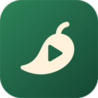

# 轻椒音乐 · ChiliPlayer



之所以产生这个项目，是因为想在 Android 6 老车机上听 U 盘里的歌，也能顺手播放自己服务器上的音乐。「轻椒」和「青椒」同音，取的是「轻量版椒盐」的意思。

## 下载与使用

[到 Releases 下载系统版 APK](https://github.com/873638060/ChiliPlayer/releases/latest)。最低支持 Android 6.0（API 23）。

0.3.7.5 换上了青椒绿图标。应用名默认显示「轻椒音乐」，英语系统显示「ChiliPlayer」。

第一次打开，点「扫描音乐」选择要导入的文件夹。有自己的 Subsonic 或 OpenSubsonic 服务器，也可以在应用里添加。应用会记住曲库、队列和播放进度，遇到播放问题时也可以从设置里导出日志。


## 参考与致谢

- **椒盐音乐（Salt Player）**。横屏曲库、底部播放栏和展开播放页参考了 12.0.0 版的界面和操作。开发时也看过发行 APK 的曲库和播放行为，没直接移植的椒盐应用源码。轻椒音乐是独立维护的项目。
- **Tempus**。Subsonic 的专辑浏览、搜索和串流接口，以及 ReplayGain 的预读、缓存和切歌处理，都参考了 Tempus ，没直接移植的 Tempus 应用源码。[Tempus 上游仓库](https://github.com/eddyizm/tempus)

## 自己构建

在 Windows PowerShell 里构建。准备好 Android SDK Platform 36、Build Tools 35.0.0 和 Android Studio 自带的 JBR，然后在项目根目录运行：

```powershell
.\car\build.ps1
```

如果工具装在自定义位置，可以设置 `ANDROID_SDK_ROOT`（也支持 `ANDROID_HOME`）和 `SALTPLAYER_JDK`。APK 会生成在 `dist/`，首次构建会使用本机测试签名。覆盖安装需要和原应用使用同一签名。

[测试说明](car/tests/README.txt)里有系统版回归的步骤。测试会写入测试账号、曲库和队列，请用独立模拟器跑。

## 许可证

源码按 GPL-2.0-or-later 发布。[GPL 第 2 版全文](LICENSE) · [JMAC 第三方声明](car/assets/licenses/NOTICE.txt)
